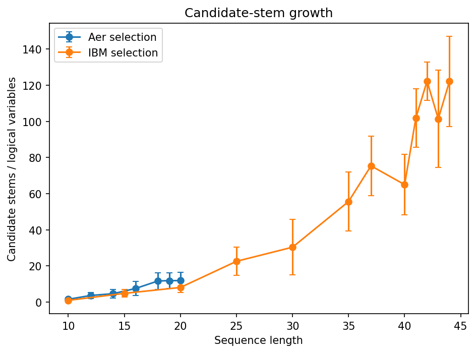
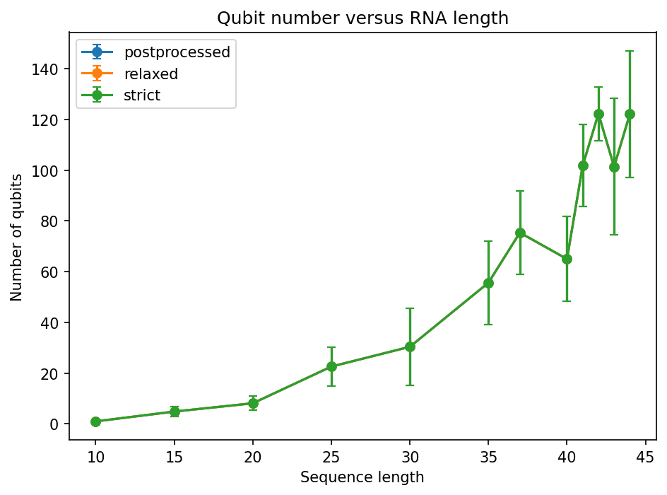
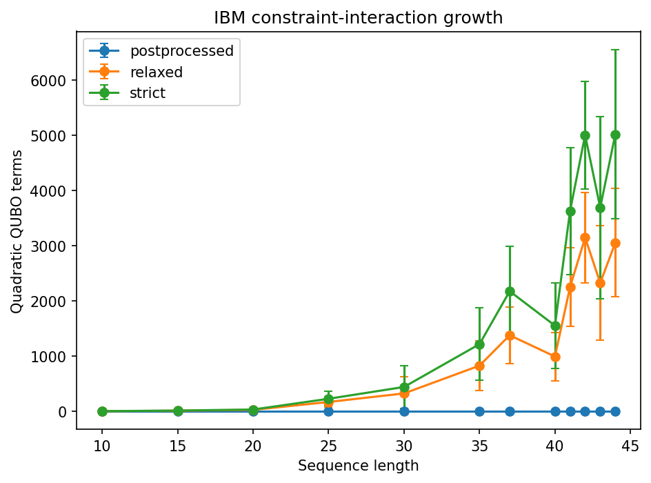
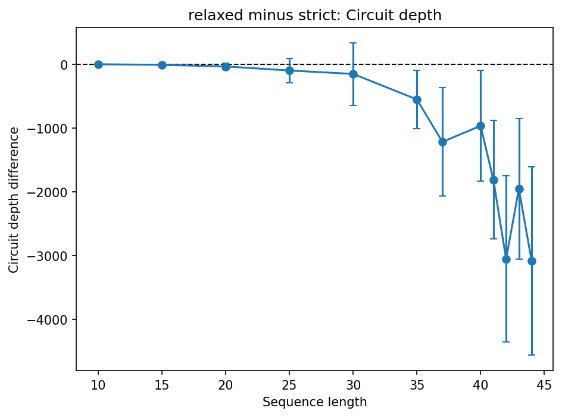
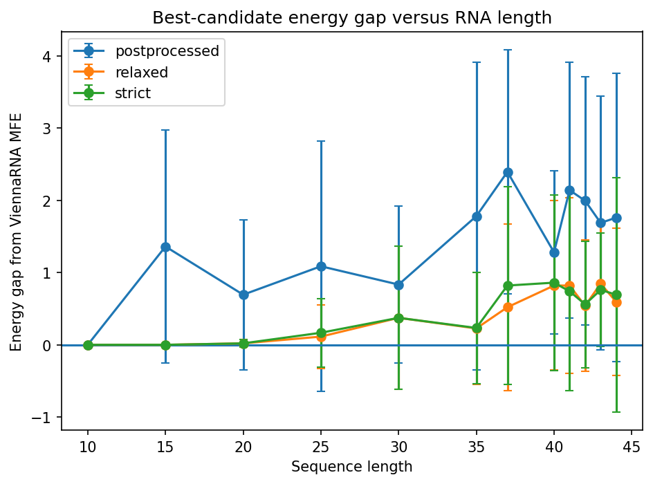
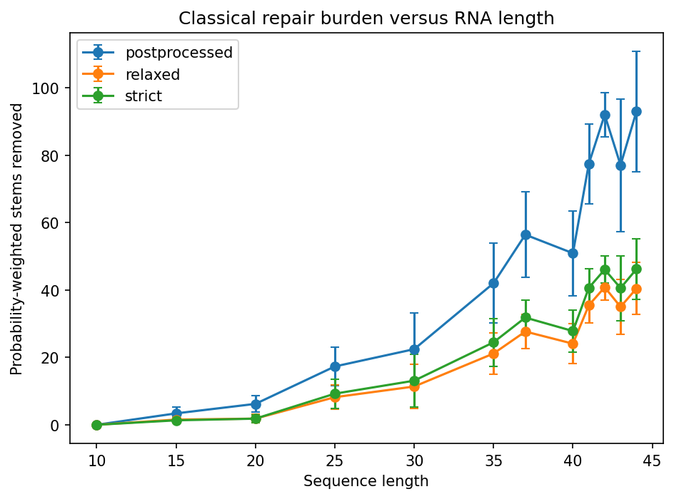
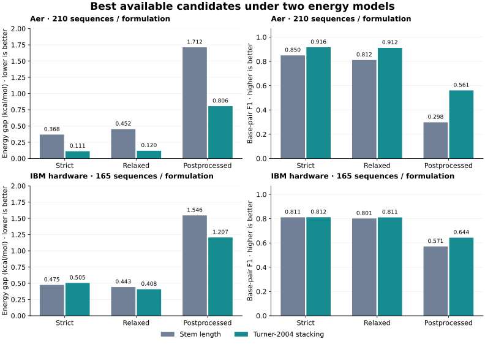

# Hybrid quantum sampling for RNA secondary structure

**Constraint placement across stem-length and Turner-2004 stacking models**  
Author: Sergey Grigorovich

This study examines how quantum circuits and classical processing can share the work of constructing RNA secondary structures. QAOA produces a finite pool of candidate stem selections; classical processing repairs structural conflicts and evaluates the resulting structures. The central question is whether a useful candidate pool requires every structural constraint to be encoded in the quantum circuit.

The experiment proceeds in two stages. **Stage 1 uses stem length as a basic structural score** to isolate the effects of constraint placement. **Stage 2 introduces Turner-2004 nearest-neighbor stacking energies** to test whether the conclusions persist with sequence-dependent thermodynamic information. Both stages compare strict, relaxed and postprocessed formulations on the same selected sequences and candidate stems, using matched execution settings and the same classical evaluation.

Across both models, relaxed encoding preserves comparable best-candidate quality to strict encoding while reducing circuit depth. Turner stacking improves several candidate-quality measures and makes the fully postprocessed formulation more competitive, but does not remove its larger repair burden or its weaker best-candidate quality.

## 1. Research question and hybrid workflow

RNA secondary structure influences molecular stability and function, including properties relevant to mRNA design. Classical software such as ViennaRNA provides thermodynamic structure evaluation and minimum-free-energy (MFE) prediction. Here, ViennaRNA evaluates sampled structures and supplies a common reference for comparing the quantum formulations.

**The quantum circuit is used as a candidate sampler within a hybrid workflow.** It is not required to return the best structure as its most frequent outcome. Each final sampling run uses 2,048 shots, producing at most 2,048 distinct bitstrings; deterministic repair can map several bitstrings to the same structure. This bounded set can be evaluated classically in full. The primary measure of usefulness is the quality of the best structures available in that pool at the fixed sampling budget, considered alongside circuit resources and repair burden.

QAOA parameters are trained against a QUBO objective, but the QUBO score guides candidate generation rather than replacing downstream thermodynamic evaluation. The most frequent repaired structure and the lowest-QUBO-score sample are additional diagnostics of the sampled distribution. Neither is required to be the final hybrid prediction.

The workflow is:

1. Enumerate candidate stems and identify nucleotide-overlap and crossing conflicts.
2. Assign either stem-length scores or Turner-2004 internal stacking energies.
3. Construct a strict, relaxed or postprocessed QUBO and prepare a shallow QAOA circuit.
4. Sample a finite set of bitstrings on Aer or IBM hardware.
5. Repair conflicts deterministically, evaluate full ViennaRNA structure energies and aggregate probabilities for identical repaired structures.
6. Assess the best available candidate, the sampled distribution, repair burden and quantum resources.

The study asks whether encoding more constraints produces a sufficiently better candidate pool to justify the additional circuit cost, and whether this tradeoff survives a richer energy model.

## 2. Two energy models, three constraint formulations

### Shared stem representation

Each binary variable selects one candidate stem consisting of consecutive antiparallel base pairs. Allowed pairs are A–U, G–C and G–U in either orientation. Stems contain at least two base pairs and satisfy a minimum innermost loop separation of three nucleotides. Nonmaximal substems are included.

Two stems conflict if they share a nucleotide or contain crossing base pairs. Every sampled selection passes through the same greedy repair procedure: consider longer stems first, break remaining ties by stem ID, and retain a stem only if it neither overlaps nor crosses a previously accepted stem. This length-based ordering is retained in both energy-model stages.

### Stage 1: stem-length scoring

For a stem containing $L_i$ base pairs, the linear coefficient is

```math
e_i^{\mathrm{length}}=-L_i.
```

For compatible selections, minimizing this score maximizes the total number of paired bases. It provides a simple baseline for studying constraint placement without introducing detailed thermodynamic terms. Maximum-pairing models have an established history in RNA structure algorithms [1], and stem-length rewards have also been used in quantum RNA models [2]. The present objective is a simpler structural proxy than the full Hamiltonian of Fox et al.; it has no thermodynamic units.

### Stage 2: Turner-2004 internal stacking energies

The second stage replaces the length score with the sum of nearest-neighbor stacking free energies inside each candidate stem:

```math
e_i^{\mathrm{stack}}
=\sum_{k=1}^{L_i-1}\Delta G^{\circ}_{37}(p_{i,k},p_{i,k+1}),
```

where $p_{i,k}$ and $p_{i,k+1}$ are adjacent base pairs in the stem. Parameters are taken from ViennaRNA's Turner-2004 table at 37°C and converted to kcal/mol. These established, experimentally informed parameters distinguish different adjacent base-pair combinations [3,4]. Favorable coefficients are negative; zero and positive coefficients are retained, and stems are not filtered by energy.

This is **stacking-weighted stem selection**, a partial thermodynamic model. It includes internal stacks but omits terminal, hairpin, bulge, internal-loop, multibranch-loop and exterior-loop contributions. Stacking across the boundary between separately selected stems is also omitted. Consequently, it is not a complete Turner MFE objective, and different partitions of a helix into stem variables can receive different QUBO scores. Full ViennaRNA structure energies are evaluated after sampling in both stages.

The richer score changes the linear coefficients without adding binary variables or conflict edges. This makes it possible to examine whether the constraint-placement conclusions depend on the use of a length-only proxy.

### Constraint placement

Let $x_i\in\{0,1\}$ select stem $i$, $O$ denote overlapping stem pairs and $C$ denote crossing stem pairs. The coefficient $e_i$ comes from the energy model used in that stage.

| Formulation | QUBO conflict penalties | Classical repair |
|---|---|---|
| **Strict** | Overlap and crossing | Removes any remaining overlap or crossing |
| **Relaxed** | Overlap only | Removes any remaining overlap or crossing |
| **Postprocessed** | None | Resolves both conflict types |

```math
\begin{aligned}
Q_{\mathrm{strict}}(x)
&=\sum_i e_i x_i+P\sum_{(i,j)\in O}x_ix_j+P\sum_{(i,j)\in C}x_ix_j,\\
Q_{\mathrm{relaxed}}(x)
&=\sum_i e_i x_i+P\sum_{(i,j)\in O}x_ix_j,\\
Q_{\mathrm{postprocessed}}(x)
&=\sum_i e_i x_i.
\end{aligned}
```

Both stages use the same penalty rule:

```math
P=1+\max\left(0,\max_i(-e_i)\right).
```

The penalty exceeds the benefit of selecting any individual stem. Removing a stem involved in an encoded conflict therefore lowers the objective, so an exact optimum satisfies the constraints encoded by that formulation. Finite QAOA samples need not reach an exact optimum, which is why all three variants use repair.

The rule is shared across energy models, but its numerical value changes with the stem coefficients. Penalties are computational constraint weights, not thermodynamic parameters. No coefficient normalization or penalty-sensitivity sweep is applied.

## 3. Experimental design

Sequences are synthetic fixed-length segments generated by concatenating randomly selected BEACON noncoding-RNA sequences and dividing them into target lengths [8]. Selection favors manageable candidate-stem counts. These are computational test instances rather than a benchmark of experimentally determined folds.

Each energy-model stage contains **630 Aer runs and 540 IBM hardware runs**, covering all three formulations. Across both stages this gives **2,340 successful variant–sequence runs**.

| Setting | Aer, per energy model | IBM hardware, per energy model |
|---|---|---|
| Sequence lengths | 10, 12, 14, 16, 18, 19, 20 | 10, 15, 20, 25, 30, 35, 37, 40, 41, 42, 43, 44 |
| Sequences per length | 30 | 15 |
| Selected sequences | 210 | 180 |
| Formulations per sequence | 3 | 3 |
| Final sampling shots per run | 2,048 | 2,048 |
| Execution | Noiseless Aer simulation | 156-qubit `ibm_quebec` |

Hardware circuits use up to **143 logical qubits**. Both stages use QAOA depth $p=1$, seed 666, COBYLA with a 25-evaluation budget, 1,024 shots per optimization evaluation, and transpilation optimization level 2. Hardware targets use their own Aer-optimized parameters when available; otherwise parameters are transferred from the successful Aer donor of the same formulation with the largest variable count.

The selected sequences, stem enumeration, conflict definitions, repair rule, saved ViennaRNA references, shot budgets and parameter-transfer policy are shared. QAOA angles are optimized separately for the two objectives; changing the coefficients also changes circuit rotation angles and may affect compiled depth. The hardware stages use the same backend at different times, so calibration and noise conditions are not identical.

 

*Stem counts and logical-qubit requirements are shared by the two energy models. Sequence length alone does not determine model size: sequence composition changes the number of candidate stems and conflicts.*

## 4. Evaluating a candidate pool

### Primary outcome: best available classical energy

All observed samples are retained and repaired; the analyzed probability mass is 1.0 in both stages. Let $\mathcal{P}$ be the set of distinct repaired structures observed in one run. The primary energy metric is

```math
\Delta E_{\mathrm{pool}}
=\min_{s\in\mathcal{P}}E_{\mathrm{ViennaRNA}}(s)
-E_{\mathrm{ViennaRNA}}^{\mathrm{MFE}}.
```

Lower values mean that the sampled pool contains a structure closer in energy to the ViennaRNA MFE reference. Because the reference energy is constant for a given sequence, **ranking candidates by energy gap is exactly equivalent to ranking them by their own ViennaRNA energy**. A classical selector can therefore recover this minimum-energy candidate from the pool without knowing the reference fold or first computing its MFE. The MFE is needed to quantify the reported gap.

The existing analysis calls its selected candidate the **sampled oracle**. It first minimizes energy gap and then uses reference base-pair F1 to resolve equal-energy ties, followed by sample probability and sample rank. Accordingly, its energy value is achievable by reference-free classical energy ranking, while its reported F1 remains reference-assisted in tied cases. F1 is measured for this energy-selected candidate; it is not the independently highest F1 anywhere in the pool.

This distinction permits a candidate-sampling interpretation without requiring the most probable quantum outcome to be optimal. It also keeps structural agreement with a known reference separate from an operational energy-based selection rule.

### Additional diagnostics

- **Objective-first:** select the observed bitstring with the lowest QUBO objective, then use its repaired structure.
- **Repaired MAP:** aggregate probabilities of bitstrings that repair to the same structure and select the most probable repaired structure.
- **Raw validity:** probability that a sampled stem selection has neither overlap nor crossing conflicts before repair.
- **Repair burden:** probability-weighted number of stems removed per sample.
- **Resources:** QUBO interactions, logical qubits, compiled circuit depth and recorded QPU usage.

Objective-first and repaired MAP measure how directly the quantum distribution identifies a good structure without full classical energy ranking. Their difference from pool-best quality is informative, but low MAP quality alone does not imply that a pool is unhelpful to the hybrid workflow.

The candidate representation is itself restricted: it excludes isolated single base pairs and pseudoknots. The **representation oracle**, the best valid structure constructible from the entire enumerated stem set, was not computed. The observed pool may therefore differ from the ViennaRNA reference because of both representation limits and finite sampling/optimization.

## 5. Results

Hardware headline tables below use the **165 sequences per formulation at lengths 15–44**, matching the original nontrivial-instance comparison. Length-10 hardware runs remain in the complete dataset. Aer summaries include all 210 sequences per formulation. The separate selection-rule table explicitly uses all 180 hardware sequences per formulation.

Energy gaps are in kcal/mol; lower is better. F1 is reference base-pair agreement for the energy-selected candidate; higher is better. Repair and validity are probability-weighted within each run, then averaged across sequences. Reported similarities are descriptive comparisons, not statistical equivalence claims.

### Stage 1: constraint placement with stem-length scoring

| Formulation | Pool-best energy gap | F1 | Stems removed | Raw validity | Circuit depth |
|---|---:|---:|---:|---:|---:|
| Strict | 0.475 | 0.811 | 25.73 | 6.66% | 5,523.6 |
| Relaxed | 0.443 | 0.801 | 22.50 | 5.35% | 4,348.0 |
| Postprocessed | 1.546 | 0.571 | 48.91 | 1.34% | 6.0 |

**Relaxed preserves comparable best-candidate quality while reducing quantum resources.** Relative to strict, it reduces mean quadratic interactions by approximately **37%** and hardware circuit depth by **21.3%**. Its energy gap is slightly smaller, with a modest F1 deficit of about 0.010.

 

The postprocessed formulation has a very shallow circuit but requires **117% more stem removals** than relaxed. Its pool-best energy gap is approximately 3.5 times larger. Under the length-only objective, every stem has a negative coefficient, so the unconstrained optimum selects all stems and leaves structural compatibility entirely to repair.

 

Strict improves raw validity on shorter hardware instances in this stage. This advantage does not persist as the models grow: from length 35 onward, strict and relaxed raw validity is close to zero, making classical repair central to both workflows.

### Stage 2: the same comparison with Turner-2004 stacking

| Formulation | Pool-best energy gap | F1 | Stems removed | Raw validity | Circuit depth |
|---|---:|---:|---:|---:|---:|
| Strict | 0.505 | 0.812 | 25.96 | 4.62% | 5,528.7 |
| Relaxed | 0.408 | 0.811 | 23.56 | 6.57% | 4,407.5 |
| Postprocessed | 1.207 | 0.644 | 32.33 | 3.74% | 6.0 |

**The main resource–quality tradeoff survives the richer objective.** Relaxed retains the same approximately 37% reduction in quadratic interactions and a **20.3% reduction in hardware circuit depth** relative to strict. Its mean pool-best energy gap is smaller than strict's, while their F1 values differ by only about 0.001.

The changes from the length-only stage are not uniform:

- **Relaxed improves modestly on hardware:** energy gap decreases from **0.443 to 0.408**, and F1 increases from **0.801 to 0.811**. Its repair burden rises slightly, from 22.50 to 23.56 stems.
- **Strict shows little overall hardware gain:** F1 stays near 0.812, while the energy gap increases from **0.475 to 0.505**.
- **Postprocessed benefits substantially:** energy gap decreases from **1.546 to 1.207** (about 22%), F1 increases from **0.571 to 0.644**, and repair burden falls from **48.91 to 32.33** stems (about 34%). It still needs about **37% more repair** than relaxed and has weaker pool-best quality.

The postprocessed objective also changes qualitatively. With stacking coefficients, its unconstrained optimum selects negative-energy stems, excludes positive-energy stems and is indifferent to zero-energy stems. It no longer necessarily selects every candidate stem. These sequence-dependent preferences can affect which combinations reach the repair stage; the experiments do not isolate this mechanism from changes in sampling and hardware noise.

Strict's earlier raw-validity advantage also reverses on the shorter nontrivial hardware instances: relaxed has higher average raw validity in the Turner experiment. Neither model restores substantial raw validity for strict or relaxed at the larger tested lengths.

### Simulation comparison

The noiseless Aer experiment shows clearer improvements in pool-best quality for all three formulations:

| Formulation | Length energy gap | Turner energy gap | Length F1 | Turner F1 |
|---|---:|---:|---:|---:|
| Strict | 0.368 | 0.111 | 0.850 | 0.916 |
| Relaxed | 0.452 | 0.120 | 0.812 | 0.912 |
| Postprocessed | 1.712 | 0.806 | 0.298 | 0.561 |

Strict and relaxed both approach higher F1 and lower energy gaps under stacking, while postprocessed makes a large improvement but remains weaker. These results apply to the shorter Aer sequence pool; the simulator and hardware aggregates cover different length ranges and should not be read as a matched estimate of hardware noise.



*Mean pool-best energy gaps and associated F1 under the two energy models. Aer: 210 sequences per formulation; hardware: 165 sequences per formulation at lengths 15–44. Means only; this figure does not show confidence intervals. Values are provided in the [comparison summary](data/results/energy_model_comparison_summary.csv).*

### What the sampled distribution adds to the picture

Using all **180 hardware sequences per formulation**, the mean energy gaps under the three selection rules are:

| Energy model | Formulation | Objective-first | Repaired MAP | Pool-best energy |
|---|---|---:|---:|---:|
| Stem length | Strict | 5.728 | 3.949 | 0.436 |
| Stem length | Relaxed | 6.123 | 4.129 | 0.406 |
| Stem length | Postprocessed | 4.646 | 5.993 | 1.417 |
| Turner stacking | Strict | 5.630 | 4.172 | 0.463 |
| Turner stacking | Relaxed | 5.568 | 4.049 | 0.374 |
| Turner stacking | Postprocessed | 4.125 | 4.786 | 1.106 |

The most probable repaired structure is often far from the best-energy structure available in the same pool. On hardware, MAP improves on objective-first for strict and relaxed in both stages, but worsens it for postprocessed. Postprocessed nevertheless has the best objective-first energy gap among the three variants, illustrating why conclusions depend on whether the target is a directly selected output or the quality of the full candidate pool.

For the proposed hybrid use, classical energy evaluation can recover the pool minimum without requiring it to have the highest sampling probability. The remaining reference assistance in the reported structural F1 is the equal-energy tie-break described above. MAP behavior is also not universal across backends: in the Turner Aer experiment, MAP improves postprocessed energy quality relative to objective-first, reversing its length-only Aer behavior.

## 6. Conclusions and scope

**The central conclusion is robust across the two tested energy models:** relaxed encoding offers the strongest observed balance between best-candidate quality, repair burden and quantum circuit cost. Strict and relaxed produce pools containing comparably good energy-selected structures, while relaxed requires substantially fewer interactions and shallower hardware circuits.

**The richer model changes the size of some differences.** Postprocessed becomes more competitive in both energy and F1 and needs much less repair, although it still trails the constrained variants in pool-best quality. Strict's raw-validity advantage on shorter hardware instances does not survive the change of energy model. Improvements in Aer are clearer than those on hardware, where strict shows no consistent overall improvement.

**Candidate generation and classical selection should be evaluated together.** A low-probability candidate can still be useful when the entire finite pool is evaluated classically. The results support studying this division of work; they do not establish an advantage over classical candidate generators or RNA-folding algorithms.

The interpretation is bounded by the following limitations:

- The sequences are synthetic segments, and instance selection favors manageable stem counts. The reference folds are ViennaRNA predictions rather than experimental ground truth.
- Turner stacking is a partial thermodynamic objective. Omitted loop and terminal terms, missing stacks between selected stems, and helix-partition dependence limit its physical fidelity.
- The stem representation excludes isolated base pairs and pseudoknots. The representation oracle was not computed.
- Pool-best F1 uses reference information to resolve equal-energy ties. It is not a validated reference-free top-1 structural prediction metric.
- The study uses shallow QAOA, limited optimization, one configured seed, parameter transfer for targets without their own Aer parameters, and a fixed final sampling budget. It does not establish sampling success rates across repeated independent seeds or shot budgets.
- Hardware evidence comes from one backend and separate execution periods. Calibration drift is not controlled, and no statistical equivalence test establishes that strict and relaxed are indistinguishable.
- Comparable-budget classical candidate-generation baselines and a complete end-to-end cost comparison are needed to assess any quantum benefit.

## 7. Reproducibility and repository layout

Install the recorded dependencies with:

```bash
python -m pip install -r requirements.txt
```

The [runtime report](colab-runtime-info.json) and [exact package snapshot](requirements-colab-freeze.txt) document the original Google Colab environment. The stem-length experiment used Python 3.12.13 and CPU-only execution. Its recorded timing was approximately 14 minutes for the simulator workflow and 28 minutes of QPU usage; the approximately 2.2-hour hardware wall time also included preparation and communication. These timing observations are not a cross-model speed comparison.

| Component | Purpose |
|---|---|
| [Execution notebook](rna_qubo_execution.ipynb) | Stem-length data preparation, model construction, Aer optimization and IBM sampling |
| [Analysis notebook](rna_qubo_results_analysis.ipynb) | Stem-length candidate evaluation, aggregation, selection diagnostics and figures |
| [data.py](src/data.py) | BEACON loading, synthetic sequences and ViennaRNA references |
| [model.py](src/model.py) | Stem enumeration, conflicts, length scoring, QUBOs and deterministic repair |
| [quantum.py](src/quantum.py) | QAOA optimization, circuit preparation and sampling |
| [analysis.py](src/analysis.py) | Candidate evaluation, per-run summaries and plotting |
| [Result tables](data/results) and [figures](figures) | Saved baseline results and the two-model comparison summary |

The baseline detailed candidate table exceeds GitHub's single-file size limit and is stored as `data/results/detailed_results.zip`; extract it before running analysis locally.

The Turner implementation uses `model_stacking.py` and separate execution and analysis notebooks. Its batch hardware version uses `model_stacking_batch.py`, `quantum_stacking_batch.py`, `rna_qubo_execution_stacking_batch.ipynb` and `rna_qubo_results_analysis_stacking_batch.ipynb`. Batch submission and result collection are separate, with job IDs and preparation metadata saved locally so collection can resume after a notebook restart. Batching changes job scheduling, not the configured circuits or shot budgets within the Turner experiment.

**Artifact availability:** the public repository currently contains the complete stem-length workflow. The Turner summaries reported here were checked against the executed Turner analysis notebook, but the Turner source files, executed notebooks and detailed result tables still need to be added to the public reproducibility archive. The comparison CSV records the aggregate values and their provenance; it does not replace those run-level artifacts.

## 8. Related work

The study follows a progression from simple RNA optimization models toward hybrid quantum–classical workflows. Maximum-pairing algorithms [1] and the stem-based quantum model of Fox et al. [2] motivate a basic structural baseline. Turner nearest-neighbor parameters [3,4] provide the established energetic information used in the second stage.

In the IBM–Moderna sequence of studies, Alevras et al. [5] explored mRNA secondary-structure optimization on utility-scale quantum hardware. Kumar et al. [6] extended the approach through classical transformations and local optimization for longer sequences. Friedhoff et al. [7] investigated compressed encoding and problem-aware decoding for dense constraints. The present experiment examines a complementary question: how much constraint enforcement should remain in the circuit when classical repair and candidate evaluation are explicit parts of the workflow?

### References

1. Nussinov, R., et al. (1978). *Algorithms for Loop Matchings*. SIAM Journal on Applied Mathematics, 35, 68–82. [DOI](https://doi.org/10.1137/0135006).
2. Fox, D. M., et al. (2022). *RNA folding using quantum computers*. PLOS Computational Biology, 18, e1010032. [DOI](https://doi.org/10.1371/journal.pcbi.1010032).
3. Xia, T., et al. (1998). *Thermodynamic Parameters for an Expanded Nearest-Neighbor Model for Formation of RNA Duplexes with Watson–Crick Base Pairs*. Biochemistry, 37, 14719–14735. [DOI](https://doi.org/10.1021/bi9809425).
4. Mathews, D. H., et al. (2004). *Incorporating chemical modification constraints into a dynamic programming algorithm for prediction of RNA secondary structure*. PNAS, 101, 7287–7292. [DOI](https://doi.org/10.1073/pnas.0401799101). Parameter documentation: [Nearest Neighbor Database](https://rna.urmc.rochester.edu/NNDB/).
5. Alevras, D., et al. (2024). *mRNA secondary structure prediction using utility-scale quantum computers*. IEEE QCE. [DOI](https://doi.org/10.1109/QCE60285.2024.00064).
6. Kumar, V., et al. (2025). *Towards secondary structure prediction of longer mRNA sequences using a quantum-centric optimization scheme*. IEEE QCE. [DOI](https://doi.org/10.1109/QCE65121.2025.00254).
7. Friedhoff, T., et al. (2026). *Pauli Correlation Encoding for mRNA Secondary Structure Prediction: Problem-Aware Decoding for Dense-Constraint QUBOs*. arXiv preprint. [DOI](https://doi.org/10.48550/arXiv.2605.20163).
8. Ren, Y., et al. (2024). *BEACON: Benchmark for Comprehensive RNA Tasks and Language Models*. NeurIPS 37, 92891–92921. [DOI](https://doi.org/10.52202/079017-2949).

### Presentation and project origins

This work originated in the Moderna Challenge of the WISER Summer Program 2026. The archived presentation covers the stem-length experiment: [video](https://www.youtube.com/watch?v=yZxfC2RZC8c) and [slides](presentation/WISER-Moderna-presentation.pdf).

### Generative AI disclosure

Gemini 2.5 in Google Colab was used for syntax completion, troubleshooting and debugging. ChatGPT was used for debugging, technical writing, language editing, analysis review and preparation of this README. Scientific claims and reported results remain the author's responsibility.
